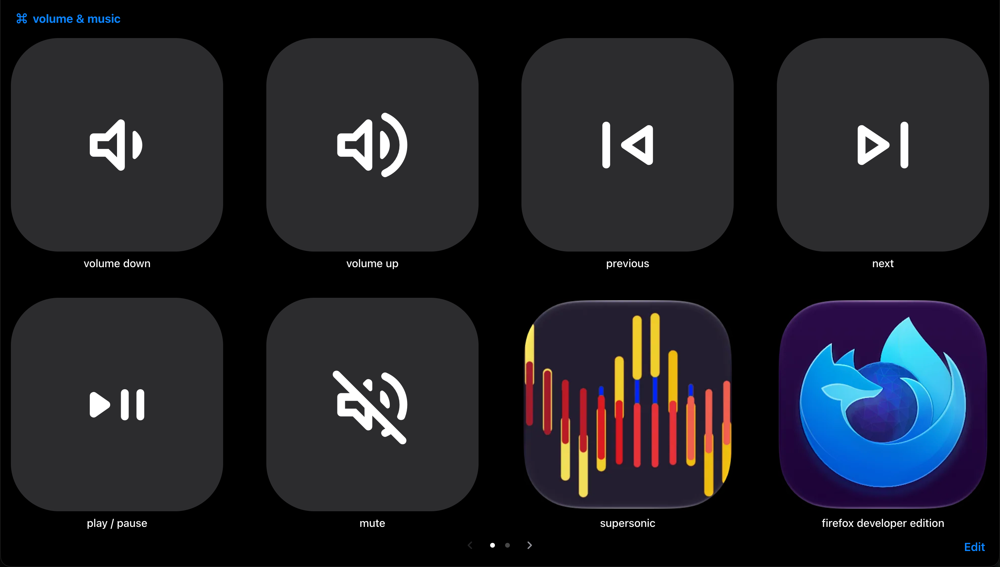

<p align="center">
  
</p>

# Macapad

A menu bar app that lets other devices control your Mac: media keys, keyboard shortcuts, opening apps and URLs,
running Shortcuts and AppleScript. Can be used by a client over http

<div align="center">
<table>
  <tr>
    <td align="center">
      <br>
      <a href="https://github.com/AD-Archer/archersdesk"><b>archersdesk</b></a>
    </td>
    <td align="center">
      <br>
      <a href="https://github.com/AD-Archer/vita-macapad"><b>vita-macapad</b></a>
    </td>
    <td align="center">
      <br>
      <a href="https://github.com/AD-Archer/3ds-macapad"><b>3ds-macapad</b></a>
    </td>
  </tr>
</table>
</div>

## Install

Apple Silicon, macOS 14 or later:

```sh
curl -fsSL https://raw.githubusercontent.com/AD-Archer/Macapad/main/scripts/install.sh | bash
```

Then allow Macapad in System Settings > Privacy & Security > Accessibility.
Homebrew and other ways: [docs/install.md](docs/install.md).

> [!WARNING]
> Keep Macapad on your local network or tailnet. Don't expose it to the internet unless you know what you're doing.

## Clients(as of right now)

- [archersdesk](https://github.com/AD-Archer/archersdesk): a web dashboard for wall screens, tablets and phones.
- [vita-macapad](https://github.com/AD-Archer/vita-macapad): a PlayStation Vita app.
- [3ds-macapad](https://github.com/AD-Archer/3ds-macapad): a Nintendo 3DS app.

## Features
- Mouse Jiggeler
- Use Client device as controller
- Stop device from sleeping
- Accesibilty settings
- Toggle wifi/bluetooth

## Docs

- [Install](docs/install.md)
- [Settings](docs/settings.md): who can reach the Mac, pausing, schedules, Wi-Fi places
- [API](docs/api.md): connecting, tokens, HTTP endpoints, status, WebSocket
- [Pairing](docs/pairing.md): finding Macs and getting a token, by code or QR
- [Steps and actions](docs/steps.md): everything the Mac can do
- [Docs page](docs/docs-page.md): try the API from your phone
- [Development](docs/development.md): building, releasing, icons
